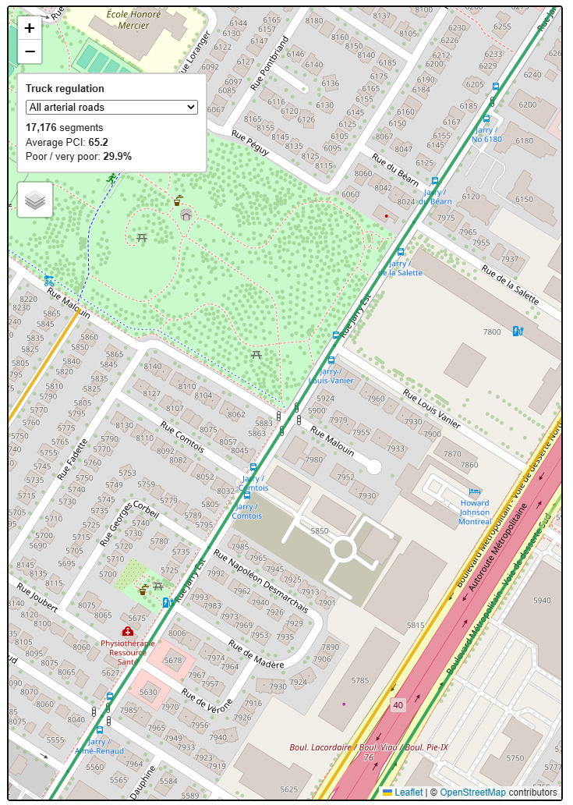
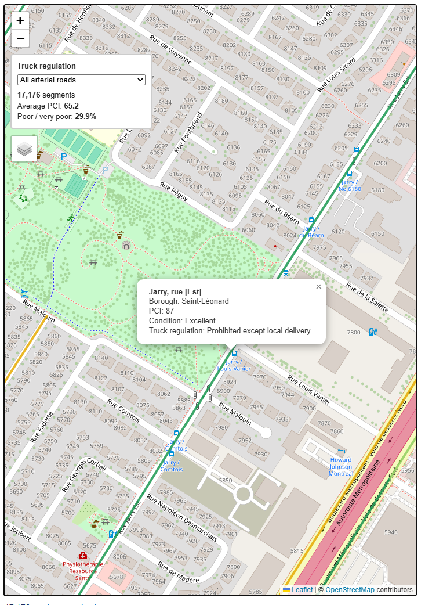

**Live site:** https://simoncarbonneau.github.io/montreal-pavement/site/

# Montréal Arterial Pavement Condition — 2024 Snapshot

## Project

The larger project looks at whether pavement condition on Montréal's arterial roads shows a pattern in relation to designated truck routes.

The map is for Montréal borough infrastructure planners and road-maintenance teams.

For this A2 version, users can explore the 2024 pavement-condition data by toggling condition classes and clicking road segments to inspect the street name, borough, PCI score and condition.

The truck-route comparison is not included yet, so this version does not make any claim about whether truck traffic is related to pavement condition.

The larger project uses two datasets: Montréal's pavement-condition data and the truck-route dataset. This A2 focuses only on the 2024 pavement-condition data.

## Data source

- **Dataset:** Indicateurs de condition des chaussées du réseau routier
- **Publisher:** Ville de Montréal
- **Dataset page:** [Données Québec](https://www.donneesquebec.ca/recherche/dataset/vmtl-condition-chaussees-reseau-routier)
- **Licence:** CC BY 4.0
- **Data used:** 2024 arterial network (RAAV)
- **Accessed:** September 30, 2026

## Data processing

The pipeline is in `notebooks/pavement_pipeline.ipynb`.

- Read the source GeoPackage with GeoPandas. Its original CRS is EPSG:32188.
- Keep `Rue`, `Arrondissement`, `Indice_PCI` and `Etat_PCI`, along with the line geometry, for the web map.
- Simplify the line geometry with a 5-metre tolerance for the web.
- Convert the data to EPSG:4326 for Leaflet.
- Write `data/pavement_2024.geojson` with six decimal places of coordinate precision.
- Use the final validation cell to check the feature count, CRS, Montréal bounds, required properties, geometry type and file size.

The validation currently passes with 17,176 road segments. The geometry type is LineString.

## How to run

1. Open the project folder in VS Code.
2. Open `site/index.html` with Live Server.
3. The map should load 17,176 road segments.
4. Use the top-right condition controls to toggle pavement-condition classes.
5. Click a road segment to inspect its street name, borough, PCI score and condition.

## Not in this iteration

I left the truck-route comparison out of A2 because it needs a second dataset and another spatial join. For this version, I focused on getting the pavement-condition map working properly first.

## Testing

- The notebook validation cell prints `All checks passed`.
- The page reports 17,176 road segments loaded.
- I tested the condition controls by switching the pavement-condition categories on and off.
- I clicked several road segments and checked that the street, borough, PCI score and condition appeared correctly.
- When I first loaded the adapted map, the Montréal pavement data worked but the page still had the old Vancouver sewer title. I corrected the text in `index.html`, reloaded the page and checked it again.
- I gave the map to someone who had not seen the project before. He immediately used the condition filters and clicked road segments without help. He noticed that the road-segment count stayed at 17,176 even when categories were hidden, so I changed the counter to update with the visible condition layers. I also made the road lines slightly thicker to make them easier to click.
- I also checked the source data for duplicate segment IDs and identical geometries. No duplicate `ID_TRC` values or identical road geometries were found.

## AI disclosure

**Lane:** Bring your own agent (Blue).

I used ChatGPT, GPT-5.6 Sol, and Codex in VS Code during A2. ChatGPT helped me understand the assignment requirements, troubleshoot problems and turn tasks into specific prompts for Codex. It also helped draft some wording for the page and README.

Codex in VS Code (model version not shown) inspected my project files and made bounded changes to the notebook, `app.js`, `index.html`, `style.css` and `README.md`. I generally asked it to work on one file or one behaviour at a time.

I decided to keep A2 focused on pavement condition and leave the truck-route comparison for later. I ran the notebook and tested the changes myself. The first run failed because GeoPandas was not installed, so I installed it and reran the notebook successfully. I checked that the validation printed `All checks passed`, confirmed that 17,176 road segments loaded, tested the condition switches and clicked several road segments to check the popup information. I also corrected page wording, source information and HTML formatting after reviewing the results.

AI helped with the implementation, but I made the scope decisions, ran the tests and decided what went into the final version.

## A3 Feature Tests — Written Before Implementation

### Test 1 — Truck regulation filter
**Action:** Select one truck regulation class.

**Expected:** Only 2024 pavement segments associated with that truck regulation class remain visible. Segments remain coloured according to pavement condition, and the displayed statistics update for the selected group.

### Test 2 — Return to all arterial pavement
**Action:** After selecting a truck regulation class, select “All arterial roads.”

**Expected:** All 17,176 pavement segments are shown again and the statistics return to values for the complete 2024 arterial pavement dataset.

### Test 3 — Edge case: no matching truck regulation
**Action:** Display pavement segments whose ID_TRC has no matching record in the truck regulation dataset.

**Expected:** The application handles these segments without errors, identifies them as having no matching truck regulation, and continues to display their pavement information normally.

## A3 Feature — Truck Regulation Pavement Analysis

For A3, I added a feature that combines Montréal's 2024 arterial pavement-condition data with the city's truck-regulation network using the shared `ID_TRC` road-segment identifier.

The map now lets users filter pavement segments by truck-regulation class while keeping the original PCI condition colours. It also calculates live statistics for the selected group:

- number of pavement segments
- average PCI
- percentage of segments classified as `Mauvais` or `Très mauvais`

Road popups also display the matching truck regulation.

Segments with no matching truck-regulation record are preserved and can be viewed separately instead of being removed from the map.

### Tests written before implementation

1. Selecting a truck-regulation class should show only pavement segments associated with that class, preserve PCI colours, and update the statistics.
2. Returning to `All arterial roads` should restore all 17,176 pavement segments and the overall statistics.
3. Selecting `No matching regulation` should display unmatched pavement segments without errors and keep their pavement information available.

### Test results

All three tests passed during local testing.

- Class 1 correctly displayed 6,491 pavement segments and updated the statistics.
- Returning to all arterial roads restored all 17,176 segments.
- The no-match case correctly displayed 1,494 pavement segments without breaking the application.

The pavement-condition layers were also tested in different toggle orders. Worse pavement conditions remain visually above better conditions regardless of the order in which layers are toggled.

### Implementation

The truck-regulation GeoJSON contains an `id_trc` field and the pavement dataset contains `ID_TRC`. These identifiers were converted to numeric IDs and used to join the truck-regulation information to the 2024 pavement segments.

The processed A3 GeoJSON contains the pavement information plus:

- `truck_class`
- `truck_regulation`

The web application filters these joined features in JavaScript and calculates the displayed statistics from the currently selected truck-regulation group.

### One thing I did not fully understand at first

I initially expected the truck and pavement datasets might require a spatial join. After inspecting the files, I found that both datasets use the same road-segment identifier, so most records could be joined directly using `ID_TRC`.

I also encountered a native Python/Pandas crash while grouping duplicate truck records. I replaced the failing `groupby().apply()` operation with a simpler loop that builds the truck-class lookup by road ID.

### AI use disclosure

I used ChatGPT throughout the A3 process for planning, debugging, and code assistance.

I first used it to inspect the assignment requirements and decide on a feature that would combine the pavement dataset with a second dataset. I then used it to help inspect dataset fields, compare road IDs, design the three tests before implementation, and troubleshoot the Python data-processing script.

AI-generated code was not accepted without testing. I ran the commands and scripts locally, inspected their outputs, tested the map interactively, and verified the required feature tests before keeping the implementation.

I also used AI assistance to help modify the JavaScript interface, including the truck-regulation filter, live statistics, popup information, and layer rendering order.

## How the feature works

The data join happens in `notebooks/a3_pipeline.py`.

- Lines 19–63 clean up the truck regulation data so there is basically one regulation value for each road segment ID.
- Lines 65–70 join the truck regulation data to the pavement data using `ID_TRC`.
- Lines 72–91 keep the fields needed for the site, simplify the geometry, convert it to web coordinates, and create `pavement_2024_a3.geojson`.

The main interactive feature is in `site/app.js`.

- Lines 86–127 create the truck regulation filter and the live statistics area.
- Lines 129–142 decide which road segments match the selected truck category.
- Lines 144–154 create the popup information.
- Lines 156–193 redraw the pavement roads whenever the truck filter changes.
- Lines 195–241 calculate the number of segments, average PCI, and percentage in poor or very poor condition.
- Lines 24–45 control the drawing order so roads in worse condition stay above roads in better condition.

One thing I did not fully understand at first was how the two datasets would be connected. I thought I might need a spatial join, but after checking the fields I found that both datasets use the same road segment IDs. I also ran into a Pandas crash when I first tried to group duplicate truck records, so I changed that part to a simpler loop instead.

## AI disclosure

I used ChatGPT (GPT-5.6 Sol) and Codex inside VS Code while working on A3.

I used ChatGPT mostly to help me plan the feature, inspect the datasets, write the tests before coding, and debug problems. For example, we checked how many `ID_TRC` values matched between the pavement and truck datasets before deciding how to join them.

I used Codex in VS Code for some of the later code edits, mainly changing the visible page text and cleaning up the interface.

The AI gave me code and suggestions, but I ran everything myself and checked the results. Some suggestions also had to be changed. For example, the first Pandas grouping method crashed on my computer, so that code was replaced with a simpler loop. I also tested all three A3 test cases on the local site before keeping the final feature.

The feature idea, the project direction, the datasets I chose, the testing, and the final decisions about what stayed in the project were mine.

## A3 Part 3 usability test and fix

The main issue I found during testing was selecting road segments. Some roads were hard to click, especially on mobile. I also discovered that on the live version only the Very poor red segments were actually clickable.

I fixed the interaction so all five pavement condition classes can now be clicked. I also increased the clickable area around each road without making the visible lines thicker. The existing colour order and visual priority are still preserved.

### Before

Only the Very poor red segments could be selected.

### After

All pavement condition classes can now be selected, while keeping the same visual styling.

